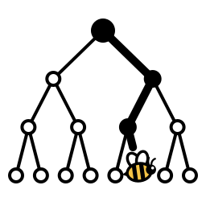
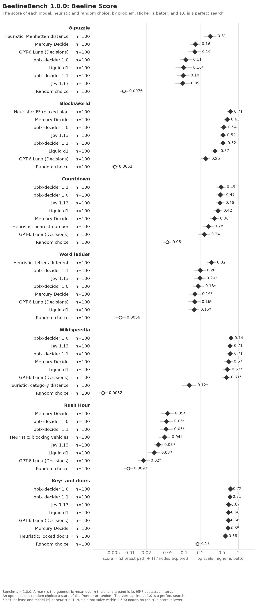
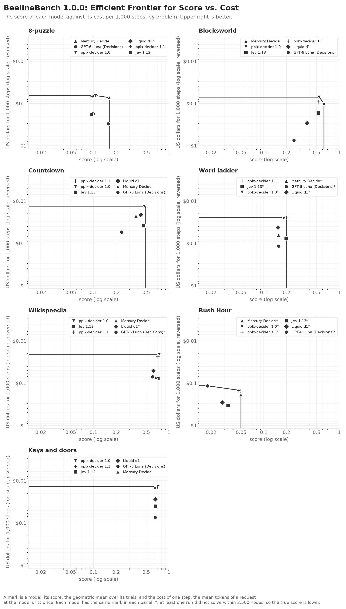
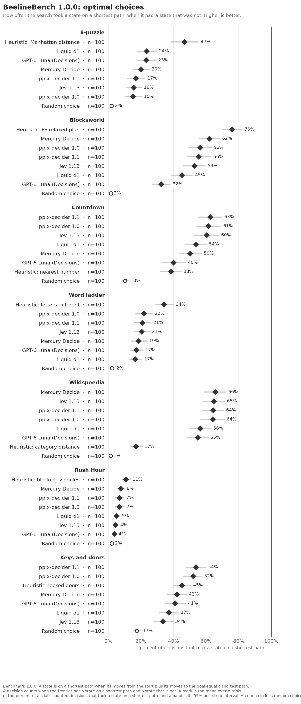

<!-- Made by `python -m beelinebench readme` from README.template.md. Edit the template, then run the command. -->

<div align="center">



# BeelineBench

**How efficiently do decision models navigate multi-step problems?**

[Results](#results) · [Method](#method) · [Domains](#domains) · [Quick start](#quick-start) · [Changelog](CHANGELOG.md) · [Citation](#citation)

[](docs/benchmarks/1.0.0.md)
[](https://github.com/kyle-pena-nlp/beelinebench/actions/workflows/ci.yml)
[](https://pypi.org/project/beelinebench/)
[](pyproject.toml)
[](https://doi.org/10.5281/zenodo.23291446)
[](LICENSE)

</div>

BeelineBench measures how well a decision model plans while it solves a multi-step problem, like Blocksworld or the sliding tile puzzle. A decision model that chooses to explore fewer unnecessary intermediate states is given a higher score. A perfect score means that the decision model 'beelined' directly to the solution along a shortest path.

- **7 domains**: sliding puzzles, planning, arithmetic, word games, and link navigation on Wikipedia.
- **Baselines**: the classic heuristic of each domain, random choice, and an oracle that knows a shortest path to the goal.
- **Seeded and portable**: the problem trials are randomly generated. An optional [master seed](docs/usage.md#master-seed) (`--seed N`) deterministically generates a different set of trials for each problem domain. The seed will produce the same trial set across machines.
- **Open harness**: configuration-driven, with a container image. Any model that uses the Jev protocol or OpenAI's Decisions API can run. [Integrate BeelineBench with your evaluation suite](docs/lab-integration.md).

> [!NOTE]
> Classic state-space search (for example, `A*`) will almost certainly remain the most efficient technique for most classic problems. BeelineBench is intended to evaluate the multi-step planning ability of decision models. It does not suggest that decision models should replace classic techniques for these domains.

## Results

| model | overall | 8-puzzle | Blocksworld | Countdown | Word ladder | Wikispeedia | Rush Hour | Keys and doors | beats the heuristic |
|---|---:|---:|---:|---:|---:|---:|---:|---:|:---:|
| Mercury Decide | **0.28\*** | **0.16** | **0.63** | 0.36 | 0.16\* | 0.67 | **0.05\*** | 0.65 | 4 of 7 |
| pplx-decider 1.0 | **0.28\*** | 0.11 | 0.54 | 0.47 | 0.18\* | **0.74** | **0.05\*** | **0.72** | 4 of 7 |
| pplx-decider 1.1 | 0.27\* | 0.10 | 0.52 | **0.49** | **0.20** | 0.71 | **0.05\*** | 0.71 | 4 of 7 |
| Jev 1.13 | 0.26\* | 0.09 | 0.52 | 0.46 | **0.20\*** | 0.71 | 0.03\* | 0.67 | 3 of 7 |
| Liquid d1 | 0.22\* | 0.10\* | 0.37 | 0.42 | 0.15\* | 0.63\* | 0.03\* | 0.66 | 3 of 7 |
| GPT-6 Luna (Decisions) | 0.19\* | **0.16** | 0.25 | 0.24 | 0.16\* | 0.61\* | 0.02\* | 0.66 | 2 of 7 |
| *Heuristic* | *0.25†* | *0.31* | *0.71* | *0.28* | *0.32* | *0.12†* | *0.04†* | *0.58* |  |
| *Random choice* | *0.01* | *0.0076* | *0.0052* | *0.05* | *0.0066* | *0.0032* | *0.0093* | *0.18* |  |

[Commentary on benchmark 1.0.0](docs/benchmarks/1.0.0-commentary.md).

\* or †: at least one model (\*) or heuristic (†) run did not solve within 2,500 nodes, so the true score is lower. The overall score is the geometric mean of the domain scores.

## Diagnostic Plots

<details>
<summary><b>Scores by domain, with 95% intervals</b></summary>



</details>

<details>
<summary><b>Score against cost, with the efficient frontier</b></summary>



</details>

<details>
<summary><b>Percent of decisions that took a state on a shortest path</b></summary>



</details>

[All benchmark versions and their figures](docs/benchmarks/README.md)

## Method

The decision model is used to rank the frontier of open states in a best-first search. At each step, the search sends all open states to the model in one request. The search stops when it finds the goal.

Before the search, a breadth-first search finds a shortest path to the goal. The score is the number of nodes in the shortest path to the solution divided by the number of nodes that the model explores.

```
score = (shortest path + 1) / nodes explored with the model
```

BeelineBench also gives other measures on the same trials:

| measure | what it is | where |
|---|---|---|
| heuristic score | the same score for the classic heuristic of the domain. A model is better than the heuristic when its score is higher. | the score figure, and the page of each benchmark |
| random choice | the same score for a chooser that takes a state of the frontier at random. It is the floor: a model below it has choices that carry no information. The figures show it as an open circle. | the score figure, and the page of each benchmark |
| optimal choices | the percent of decisions that took a state on a shortest path, averaged over the trials. A decision counts when the frontier has a state on a shortest path and a state that is not. | the optimal choices figure, and the page of each benchmark |
| oracle score | the same score for a chooser that knows the true distance to the goal. It is below 1.0 only when the frontier limit drops a state of the shortest path. | `report` |
| path score | the shortest path divided by the length of the path that the model found, over the trials that it solved. 1.0 means that the model's path is a shortest path. | `report` |
| refusals | the share of the model's requests that it refused. Only OpenAI's Decisions API refuses. The chooser then asks once more with the options in a new order. If the API refuses that question too, the chooser takes the first option of the new order. | `report`, and [Model quirks](docs/model-quirks.md) |

Each run stops at 2,500 explored nodes. A run that stops unsolved counts as 2,500 nodes, and its score gets \* (model) or † (heuristic).

The frontier holds a maximum of 255 states. If it holds more, the search drops states at random. [The frontier limit of 255 states](#the-frontier-limit-of-255-states) gives the details.

## Domains

- **8-puzzle** ([Wikipedia](https://en.wikipedia.org/wiki/15_puzzle)): the player slides eight numbered tiles on a 3 × 3 board until the tiles are in order.
- **Blocksworld** ([Wikipedia](https://en.wikipedia.org/wiki/Blocks_world)): a robot hand moves blocks, one at a time, until the blocks are arranged according to the goal state.
- **Countdown** ([Wikipedia](https://en.wikipedia.org/wiki/Countdown_(game_show))): the player combines four numbers with addition, subtraction, multiplication, and division in order to make a target number.
- **Word ladder** ([Wikipedia](https://en.wikipedia.org/wiki/Word_ladder)): the player changes one letter at a time to get from a start word to a target word, but each intermediate step must be a real word.
- **Wikispeedia** ([SNAP](https://snap.stanford.edu/data/wikispeedia.html)): the player clicks links from one Wikipedia article to the next, until the player gets to the target article.
- **Rush Hour** ([Wikipedia](https://en.wikipedia.org/wiki/Rush_Hour_(puzzle))): the player slides cars and trucks on a 6 × 6 board until the red car can leave through the exit. The model gets the board as six rows of letters and dots, divided by `|`.
- **Keys and doors**: the player walks through the rooms of a building to the exit. Each door has a color, and the key of the same color opens it. The keys are in the rooms, and a key can be behind a different door. The model gets the building as a list of statements in a random order, for example "The red key is behind the blue door."

## Quick start

Run the mini benchmark: the first 20 trials of each domain with pplx-decider 1.1 and pplx-decider 1.0. A `PERPLEXITY_API_KEY` is required in `.env`. [Price estimates](docs/costs.md) gives its price.

```bash
git clone https://github.com/kyle-pena-nlp/beelinebench && cd beelinebench
uv sync --extra plot
uv run python -m beelinebench baseline      # the heuristic and the oracle alone; sends no requests
uv run python -m beelinebench run --mini    # sends paid requests
uv run python -m beelinebench report
```

> [!CAUTION]
> `run` sends paid API requests. The model sends one request for each node that it explores.


## Limitations

### The frontier limit of 255 states

A Jev question holds a maximum of 255 options. When the frontier holds more than 255 states, the search drops states at random until 255 states remain. In order to avoid unfair comparisons, we apply this same limitation to the heuristic baseline and oracle. We plan to revisit this decision in the next version of this benchmark.

### Decision models are sensitive to the presentation

A decision model can give a different answer when it gets the same options in a different form. Two examples of this behavior are known:

- **The order of the options.** Jev prefers options near the start of a list. Thus, the chooser puts the options in a new random order for each question. The order comes from seeded draws for each trial and model.
- **The text of the options.** [JevChat](https://github.com/kyle-pena-nlp/jevchat) uses Jev to write text one symbol at a time. Jev chooses much better when each option is the full text so far, not only the next symbol. We suspect that this sensitivity to presentation is a common feature across problem domains.

The [sensitivity studies](#sensitivity-studies) measure these effects on one problem.

### Some APIs have no seed

The Jev protocol accepts only the fields `model`, `state`, and `questions`. It rejects all other fields, for example `seed` or `temperature`. Jev, pplx-decider, Clef, and the models on OpenRouter use this protocol. BeelineBench also sends no seed to OpenAI's Decisions API.

Identical requests can give different probabilities. In one test, the top option of Jev got 0.78, 0.78, and 0.83 in three calls. A different choice early in a search changes the remainder of the search. Thus, a second run of the same trial can give a different score.

BeelineBench fixes its own random values: the trials, the option order, and the dropped states. It cannot fix the answers of the model, so the results are not fully deterministic. The 95% interval does not include this variation. The repeatability study under [Sensitivity studies](#sensitivity-studies) measures it on one problem.

### The models and their APIs have quirks

Some behaviors of the models and their APIs affect their scores. [Model quirks](docs/model-quirks.md) describes each known behavior and how this benchmark handles it.

### Sensitivity studies

How sensitive is the benchmark to factors like how the problem domain is presented?

- [Representation sensitivity](docs/benchmarks/1.0.0-representation-sensitivity.md)
- [Order sensitivity](docs/benchmarks/1.0.0-order-sensitivity.md)
- [Repeatability](docs/benchmarks/1.0.0-repeatability.md)

## Related benchmarks

These benchmarks also measure decision models. Each one asks single questions. BeelineBench asks a sequence of questions, in which each choice changes the next question.

- [Decision Index](https://huggingface.co/spaces/multimodalart/jev-decision-index) ([code](https://github.com/apolinario/decision-index), [Cloudflare's copy](https://clef-evals.workers-ai-mle.workers.dev/)): more than 70 decision models, on single questions and games.
- [S1MB](https://huggingface.co/blog/hotchpotch/system-one-mosaic-benchmark) ([code](https://github.com/hotchpotch/S1MB), [leaderboard](https://huggingface.co/spaces/hotchpotch/S1MB-leaderboard)): 137 benchmarks of yes-or-no, choice and score questions, from NLP datasets. A Borda ranking combines them.
- [AIM-Decision](https://aimultiple.com/decision-models) (AIMultiple): 1,655 classification questions, and 50 browser tasks. It compares decision models with general LLMs.
- [OpenRouter decision model rankings](https://openrouter.ai/rankings/decisions): the number of requests to each model. It does not measure accuracy.

## Contributing

We welcome proposals for new models and problems. Please consult the [contribution guide](CONTRIBUTING.md). AI-assisted code is okay, but a person must write the description of a pull request, and it must match the contents of the pull request in all material ways.

## Citation

If you use BeelineBench, cite it as follows. Give the benchmark version that you used, because the code and the benchmarks have separate versions.

```bibtex
@software{pena2026beelinebench,
  author  = {Pena, Kyle},
  title   = {{BeelineBench}: How Efficiently Do Decision Models Navigate Multi-Step Problems?},
  year    = {2026},
  version = {1.0.1},
  note    = {Benchmark 1.0.0},
  doi     = {10.5281/zenodo.23291446},
  url     = {https://github.com/kyle-pena-nlp/beelinebench}
}
```

If you publish results on the Wikispeedia domain, also cite the two papers of its dataset: West and Leskovec, "Human Wayfinding in Information Networks" (WWW 2012), and West, Pineau, and Precup, "Wikispeedia: An Online Game for Inferring Semantic Distances between Concepts" (IJCAI 2009).

## License

BeelineBench is licensed under the [Apache License, Version 2.0](LICENSE). [NOTICE](NOTICE) lists the third-party data and its terms:

- The word list of the word ladder domain is from Donald E. Knuth's Stanford GraphBase, which is in the public domain.
- The Wikispeedia data is from the [Stanford Network Analysis Project](https://snap.stanford.edu/data/wikispeedia.html). SNAP gives no license for it. Thus, BeelineBench and its Docker image do not include it. A run fetches it from SNAP when it needs it.

## Support BeelineBench

Each run of a hosted model costs money. The full runs of the six models in 1.0.0 cost about $120 in API fees. The pilots and the sensitivity studies cost about $30 more. Some models were not included due to their expense. To pay for more models and new versions of the benchmark, [sponsor BeelineBench on GitHub](https://github.com/sponsors/kyle-pena-nlp).
